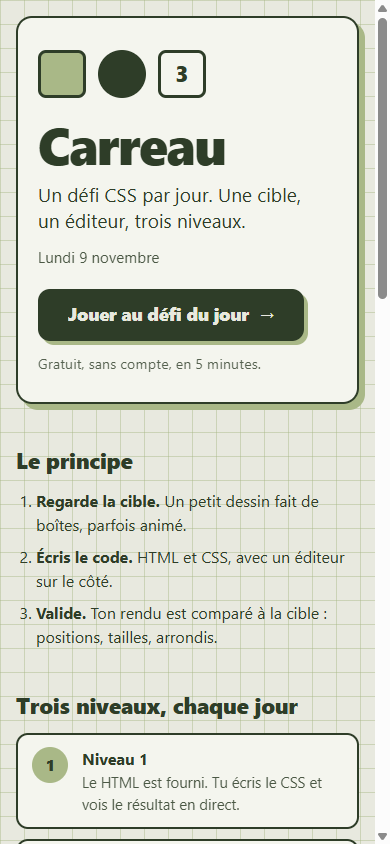
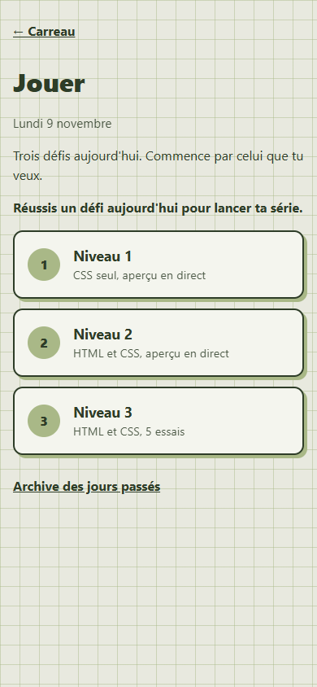
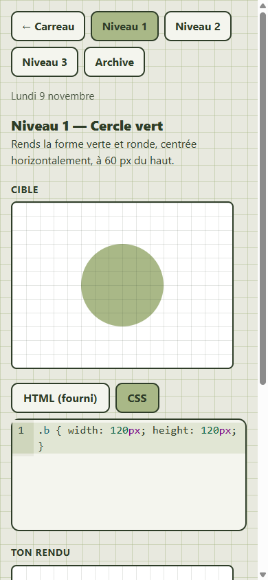

# Carreau

**Un défi CSS par jour.** Une cible s'affiche, tu la reproduis en HTML et en CSS. Trois niveaux chaque jour, plus durs le dimanche.

**Jouer : [carreau.projectp.fr](https://carreau.projectp.fr)**

Jour 25 du défi « 30 jours, 30 projets ».

| Accueil | Choix du niveau | Un défi (niveau 1) |
| --- | --- | --- |
|  |  |  |

## Pourquoi

Avec l'arrivée des IA, on ne prend plus le temps de retenir les bases : centrer une div, `flex-wrap`, animer un rond. On demande, ça marche, on oublie. Un petit rafraîchissement de mémoire ne fait pas de mal : Carreau en sert un chaque jour, sans IA.

## Le jeu

- **Niveau 1** : HTML fourni, éditeur CSS, aperçu en direct.
- **Niveau 2** : éditeurs HTML et CSS, aperçu en direct.
- **Niveau 3** : éditeurs HTML et CSS, sans aperçu avant validation, 5 essais.
- Le dimanche, les trois défis sont plus durs.
- Score (essais, indice), étoiles « CSS golf », série de jours, résumé à partager (avec le lien du site), archive des jours passés.
- Pas de compte : tout est stocké dans le navigateur (`localStorage`).

La validation compare, instant par instant, les positions, tailles et arrondis des éléments du joueur avec ceux de la cible, dans un iframe isolé (`sandbox`, CSP sans réseau). Les couleurs ne comptent pas. Aux niveaux 2 et 3, deux validations doivent être espacées de 5 secondes.

## Pages

| Route | Contenu |
| --- | --- |
| `/` | Vitrine : à quoi ça sert, principe, niveaux, aperçu animé, bouton « Jouer » |
| `/jouer` | Les 3 défis du jour et la série |
| `/jouer/1`, `/jouer/2`, `/jouer/3` | Un défi |
| `/archive` | Rejouer les jours passés (ne compte pas pour la série) |

## Développer

```bash
npm install
npm run dev      # http://localhost:3000
npm test         # tests unitaires (Node)
npm run lint
npm run build
```

Pile : Next.js 16, React 19, TypeScript, CodeMirror 6. Interface mobile first, en français.

## Contenu

Les défis sont écrits à la main dans `lib/defis/` (20 par niveau, dont 4 « durs »). Le défi du jour est tiré de la date (`lib/jour.ts`). Les dimensions des défis sont en multiples de 10 ou 20 px, pour le quadrillage de la cible.

## Déploiement

`Dockerfile` en trois étapes (sortie Next.js `standalone`), port 3000. Déployé sur Coolify, branche `master`, à l'adresse [carreau.projectp.fr](https://carreau.projectp.fr).

Le suivi détaillé du projet (demandes, décisions, tests, échecs) est dans `CLAUDE_CONTEXTE.md`.
